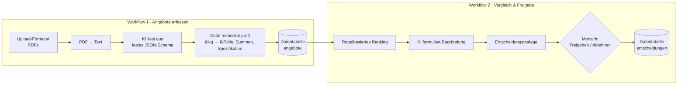
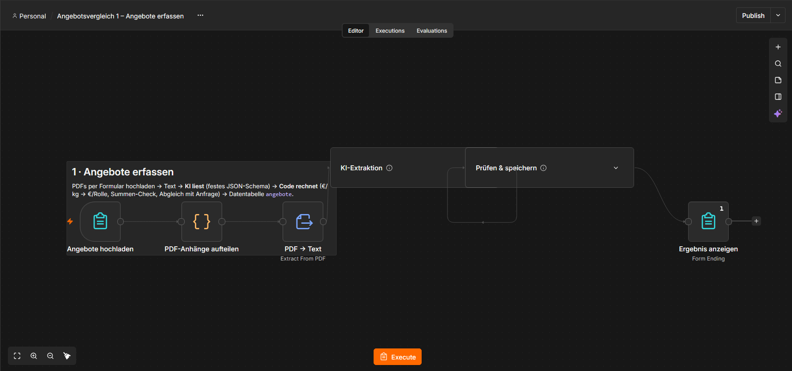
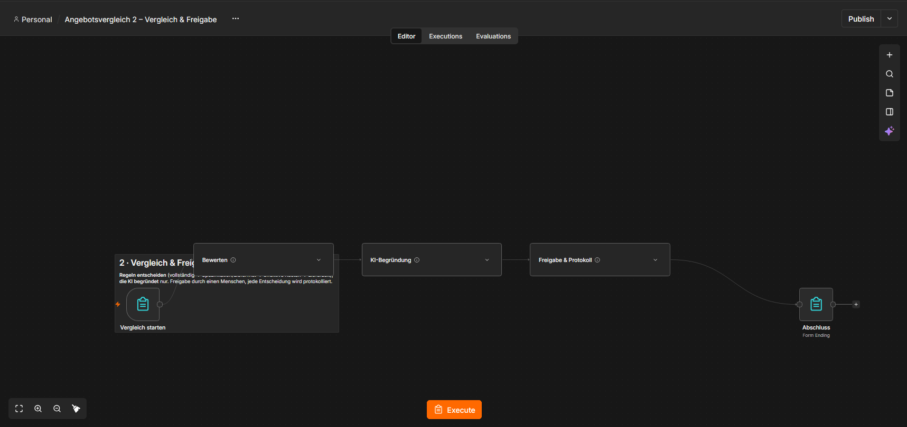
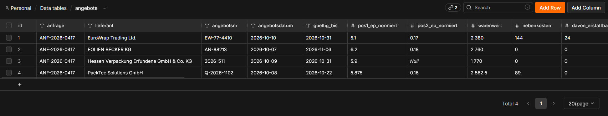
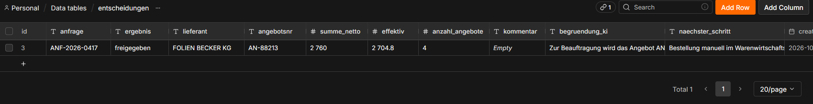

# KI-gestützter Angebotsvergleich im Einkauf (n8n)

Lieferantenangebote kommen in jedem Format: saubere Tabellen, Fließtext, Preise pro kg statt pro Stück, Teilangebote, versteckte Frachtkosten. Der Vergleich kostet im Einkauf viel Zeit und ist fehleranfällig.

Dieses Projekt automatisiert ihn mit n8n und Claude, **ohne dem Menschen die Entscheidung abzunehmen**: Die KI liest die Angebote aus, feste Regeln bewerten sie, und am Ende gibt ein Mensch per Klick frei.

## Ablauf



## Screenshots

**Workflow 1 – Angebote erfassen:** Upload, PDF-Text, KI-Extraktion, Prüfung und Ablage



**Workflow 2 – Vergleich & Freigabe:** Bewerten, KI-Begründung, Freigabe und Protokoll



**Ergebnis der KI-Extraktion:** Alle vier Angebote, auf €/Rolle und €/Stück umgerechnet (PackTec: €/kg → 5,875 €/Rolle). Bei Hessen Verpackung fehlt Position 2.



**Protokollierte Entscheidung:** Freigabe für Folien Becker, effektiv 2.704,80 €, mit KI-Begründung und nächstem Schritt.



## Designprinzipien

- **KI liest, Code rechnet.** Die KI extrahiert nur Rohwerte nach festem Schema. Umrechnung auf vergleichbare Einheiten, Summenprüfung und der Abgleich mit der Anfrage passieren deterministisch im Code und sind damit nachvollziehbar.
- **Regeln entscheiden, KI begründet.** Rangfolge: vollständig → Spezifikation und Lieferfrist eingehalten → effektive Kosten (ohne erstattbares Pfand, abzüglich Skonto) → Lieferzeit. Die KI darf die Reihenfolge nicht ändern, sie erklärt sie nur.
- **Human in the Loop.** Nichts wird automatisch bestellt. Die Freigabe erfolgt per Formular, jede Entscheidung wird mit KI-Begründung und Kommentar protokolliert (Audit-Trail).
- **Plausibilitätschecks.** Weicht die berechnete Summe von der Angebotssumme ab oder fehlt eine Lieferzeit, wird das Angebot mit Status „prüfen“ markiert.

## Testdaten

`testdaten/` enthält eine Anfrage (ANF-2026-0417: 300 Rollen Stretchfolie, 5.000 Kantenschutzecken, Lieferung in max. 10 Arbeitstagen) und vier fiktive Angebote mit typischen Fallstricken. `erwartete_werte.json` ist das Soll-Ergebnis.

| Anbieter | Fallstrick | Ergebnis |
|---|---|---|
| Folien Becker | – (sauber) | **Empfehlung**, effektiv 2.704,80 € |
| EuroWrap | nominal günstigster, aber 20 µm statt 23 µm Folie | Rückfrage |
| PackTec | Preis pro kg, Fracht extra, 15 statt max. 10 Arbeitstage | Rückfrage |
| Hessen Verpackung | Fließtext, Staffelpreis, Position 2 fehlt | Teilangebot |

Kernaussage der Demo: **Das System nimmt nicht einfach den niedrigsten Preis.**

Im Testlauf hat die KI alle vier Angebote korrekt ausgelesen, auch die Umrechnung von €/kg auf €/Rolle und das fehlende Teil im Fließtext-Angebot.

Alle Firmen, Personen und Daten in den Testdokumenten sind frei erfunden.

## Repository

```
screenshots/ Bilder aus dem Testlauf in n8n
workflows/   n8n-Workflows zum Importieren
src/         JavaScript der Code-Nodes (zum Lesen und Testen)
tests/       Logiktest ohne n8n:  node tests/logik.test.js
testdaten/   Anfrage, 4 Angebote (PDF), Soll-Werte
tools/       Skript, das die Test-PDFs erzeugt (Python + reportlab)
```

## Einrichtung

1. In n8n zwei Datentabellen anlegen:
   - `angebote`: anfrage, lieferant, angebotsnr, angebotsdatum, gueltig_bis (Text) · pos1_ep_normiert, pos2_ep_normiert, warenwert, nebenkosten, davon_erstattbar, summe_netto, lieferzeit_wt, zahlungsziel_tage, skonto_prozent, skonto_tage (Zahl) · vollstaendig (Boolean) · fehlende_positionen, abweichungen, warnungen, hinweise, quelle_datei, status (Text)
   - `entscheidungen`: anfrage, ergebnis, lieferant, angebotsnr (Text) · summe_netto, effektiv, anzahl_angebote (Zahl) · kommentar, begruendung_ki, naechster_schritt (Text)
2. Beide Dateien aus `workflows/` importieren (Workflows → Import from File).
3. In den Datentabellen-Nodes die passende Tabelle auswählen und in den Claude-Nodes einen Anthropic-Zugang hinterlegen (auf n8n Cloud gehen auch die n8n-KI-Credits).
4. Workflow 1 starten, die vier `Angebot_*.pdf` hochladen. Danach Workflow 2 starten und freigeben.

## Ausbaustufen

- Mail-Eingang (Gmail/IMAP) statt Upload-Formular
- Anfragedaten aus einer Tabelle statt fest im Code
- Automatischer Abgleich der KI-Ergebnisse mit `erwartete_werte.json` als Qualitätskennzahl
